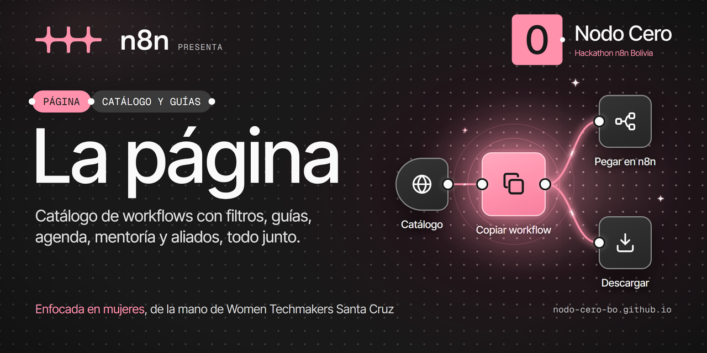

<p align="center">
  <a href="https://nodo-cero-bo.github.io">
    
  </a>
</p>

<p align="center">
  <a href="https://nodo-cero-bo.github.io"><b>Abrir la página</b></a> ·
  <a href="https://github.com/nodo-cero-bo/workflows">Workflows</a> ·
  <a href="https://github.com/nodo-cero-bo/guias">Guías</a> ·
  <a href="https://github.com/nodo-cero-bo/proyectos/issues/new?template=proyecto.yml">Registrá tu proyecto</a>
</p>

# La página de Nodo Cero

El código de **[nodo-cero-bo.github.io](https://nodo-cero-bo.github.io)**, la página de **Nodo Cero – Hackathon n8n Bolivia**: la hackathon de la comunidad n8n en Bolivia, enfocada en mujeres, de la mano de Women Techmakers Santa Cruz. Sábado 21 de noviembre de 2026, de 08:00 a 16:00, en el Centro de Educación Ambiental (CEA) del Gobierno Autónomo Departamental de Santa Cruz.

Es una página estática: HTML, CSS y un poco de JavaScript, sin frameworks y sin paso de compilación para verla. GitHub Pages la publica tal cual está en la rama `main`.

## Qué tiene

- **Portada** con el lenguaje visual de las piezas: grilla de puntos, nodos de n8n conectados con líneas rosas y puertos blancos, halos y chispas. El movimiento se apaga cuando el sistema pide menos animación (`prefers-reduced-motion`).
- **Empezá en 3 pasos:** cuentas, importar un workflow y conectar credenciales, con enlaces a las guías.
- **Catálogo de workflows** con filtros por tecnología, nivel y «sin credenciales». Cada tarjeta trae cuatro botones:
  - **Copiar workflow:** copia el JSON al portapapeles para pegarlo en el canvas de n8n con Ctrl + V (Cmd + V en Mac).
  - **Copiar enlace crudo:** para el menú de tres puntos → Import from URL.
  - **Ver en GitHub** y **Descargar** el archivo.
- **Guías** agrupadas por carpeta, leídas del repo [guias](https://github.com/nodo-cero-bo/guias).
- **Avalanche Fuji:** datos de la red (chainId 43113, RPC, símbolo AVAX), Core Wallet, faucet, Avalanche Academy, Team1 LATAM y el explorador.
- **Supabase y Clerk:** para qué sirven hoy, cómo crear la cuenta y la documentación clave.
- **Agenda** del día, que marca «AHORA» con la hora de Bolivia mientras dura el evento.
- **Mentoría**, **Registrá tu proyecto** (lleva al formulario del repo [proyectos](https://github.com/nodo-cero-bo/proyectos)), **Aliados** (n8n primero; Women Techmakers Santa Cruz; Supabase, Clerk, Team1 y Aspire Institute; la sede) y **Seguí construyendo**.

## Verla en tu compu

Desde esta carpeta, con cualquier servidor estático:

```bash
python -m http.server 8000
# o bien
npx serve .
```

y abrí <http://localhost:8000>. También podés abrir `index.html` con doble clic: se ve casi igual (algunos navegadores no cargan las tipografías desde un archivo), pero el navegador no deja que «Copiar workflow» lea los archivos sin servidor (usá «Descargar» o levantá el servidor).

La agenda marca «AHORA» con la hora de Bolivia durante el 21 de noviembre. Para ver cómo queda en otro momento del día, agregá `?ahora=` a la dirección, por ejemplo <http://localhost:8000/?ahora=2026-11-21T13:00>.

## Regenerar el catálogo

El catálogo sale de los `meta.json` y `workflow.json` del repo [workflows](https://github.com/nodo-cero-bo/workflows). Con los repos uno al lado del otro (como en `github_nodo_cero/`):

```bash
node tools/construir.mjs
```

Necesita Node 22 o más nuevo y no instala nada. Qué hace:

1. Lee cada `<categoria>/<id>/meta.json` y su `workflow.json`, y valida los campos (categoría, nivel, tecnologías, `probado`).
2. Escribe `data/catalogo.json`, que lee la página, y `data/catalogo.js`, la misma copia para cuando se abre sin servidor.
3. Copia cada `workflow.json` a `workflows/<id>.json`, para que «Copiar workflow» y «Descargar» funcionen desde el mismo dominio.
4. Lee las guías del repo `guias` y pinta sus tarjetas en `index.html`, agrupadas por carpeta, junto con los enlaces de «Empezá en 3 pasos».
5. Si cambió la organización en `config.json`, actualiza los enlaces.

Los workflows de la lista oficial que todavía no existen quedan en el catálogo con la etiqueta «pronto» y sus botones apagados. Para dejarlos afuera:

```bash
node tools/construir.mjs --sin-pendientes
```

Si los repos están en otro lado: `node tools/construir.mjs --workflows ../workflows --guias ../guias --config ../config.json`.

### Otras piezas

- `tools/piezas.mjs` arma el flujo de nodos de la portada (versión compu y celular) y la grilla de mentoría desde `data/mentoria.json`. Se corre a mano cuando cambia algo: `node tools/piezas.mjs`.
- `tools/og.html` es la fuente de `assets/og.png`, la vista previa de 1200 × 630 que muestran WhatsApp, LinkedIn y X. Se renderiza con Chrome sin interfaz:

  ```bash
  chrome --headless --hide-scrollbars --window-size=1200,630 --virtual-time-budget=4000 --screenshot=assets/og.png tools/og.html
  ```

## Publicarla

En el repo de GitHub: **Settings → Pages → Build and deployment → Deploy from a branch**, rama `main`, carpeta `/ (root)`. El archivo `.nojekyll` evita que GitHub procese la página, y `404.html` atiende las direcciones que no existen.

## Medir el aporte a los sponsors

Los enlaces a Core Wallet, Avalanche Academy y Team1 llevan parámetros UTM (`utm_source=nodo-cero`, `utm_medium=sitio`, `utm_campaign=hackathon-n8n-bolivia-2026`) para que cada equipo de sponsor vea cuántas personas llegaron desde la página. Las visitas al repo y los proyectos registrados se cuentan con el workflow `42-reporte-kpis` del repo [workflows](https://github.com/nodo-cero-bo/workflows).

## Carpetas

```
index.html            la página
404.html              página para direcciones que no existen
assets/css/           estilos
assets/js/app.js      catálogo, copiar, filtros, agenda en vivo, menú y chispas
assets/fuentes/       Inter Tight y Geist Mono (SIL OFL 1.1)
assets/logos/         logos oficiales de cada marca, sin cambios
assets/mentoria/      fotos de la mentoría
data/                 catalogo.json, catalogo.js, guias.json y mentoria.json
workflows/            copia de cada workflow.json (la genera construir.mjs)
tools/                construir.mjs, piezas.mjs y og.html
```

## Licencias

- El código de la página es **MIT** ([LICENSE](LICENSE)). Las guías del repo `guias` son CC BY 4.0.
- Los **logos** de n8n, Women Techmakers Santa Cruz, Supabase, Clerk, Team1, Aspire Institute, el Gobierno Autónomo Departamental de Santa Cruz y Nodo Cero son de sus marcas y no entran en ninguna licencia de este repo. Se usan tal cual los entregan sus marcas, sin redibujar ni recolorear (el de Aspire Institute, que no tiene versión para fondo oscuro, va sobre una placa clara).
- Las tipografías **Inter Tight** y **Geist Mono** tienen licencia SIL OFL 1.1 (ver `assets/fuentes/`).
- Las **fotos de la mentoría** se publican con el consentimiento de cada persona, nada más para esta página: no se reutilizan.

Hecho por la comunidad n8n en Bolivia.
